  

<strong>Software engineering · systems · AI and data · thoughtful interfaces</strong>

I'm **Aarya Lalan**, a first-year **BTech Computer Science and Engineering (Core) student at VIT Chennai**. I learn by building projects that make their design decisions and limitations inspectable. My projects span a C++20 storage engine, Python data and engineering pipelines, AI-enabled prototypes, and frontend interfaces for decision-support systems.

## Selected work

### Personal projects

| Project | What it demonstrates |
|---|---|
| [ASTRA-66](https://github.com/Aarya801/ASTRA-66) | A parametric student airframe design with CAD, analysis, simulation, data-only avionics software, and automated validation. It is an educational design; nothing has flown and it is not flight certified. [Engineering method](https://github.com/Aarya801/ASTRA-66/blob/main/documentation/ENGINEERING_METHOD.md) · [Validation](https://github.com/Aarya801/ASTRA-66/blob/main/documentation/VALIDATION.md) · [CAD renders](https://github.com/Aarya801/ASTRA-66/tree/main/images) |
| [MiniDB](https://github.com/Aarya801/MiniDB) | An educational C++20 persistent key-value engine: hash table, snapshots, checkpointed WAL recovery, LRU cache, transactions, and synchronized access. It does not promise power-loss durability or concurrent transaction isolation. [Design decisions](https://github.com/Aarya801/MiniDB/blob/main/docs/DESIGN_DECISIONS.md) · [WAL contract](https://github.com/Aarya801/MiniDB/blob/main/docs/WAL.md) · [Benchmarks](https://github.com/Aarya801/MiniDB/blob/main/docs/BENCHMARKS.md) |
| [J.A.R.V.I.S.](https://github.com/Aarya801/my-jarvis) | A Python/PySide6 Windows desktop assistant with registered tools, permission-gated automation, optional local AI, and SQLite audit logging. The setup guide documents the current desktop app; an older browser prototype remains separate. [Architecture](https://github.com/Aarya801/my-jarvis/blob/main/docs/ARCHITECTURE.md) · [Desktop setup](https://github.com/Aarya801/my-jarvis/blob/main/docs/SETUP.md) · [Test plan](https://github.com/Aarya801/my-jarvis/blob/main/docs/TESTING.md) |
| [AI Travel Analyst](https://github.com/Aarya801/vit-chennai-ai-travel-analyst) | A Python and Streamlit flight-price analysis project with a reproducible departure-date CatBoost evaluation. Test MAE is 13,100.29 versus 54,091.92 for the training-median baseline. Departure-date order is not quote-time validation and does not establish prospective fare accuracy. [Evaluation protocol and results](https://github.com/Aarya801/vit-chennai-ai-travel-analyst/blob/main/docs/EVALUATION.md) · [JSON report](https://github.com/Aarya801/vit-chennai-ai-travel-analyst/blob/main/artifacts/chronological_evaluation.json) |
| [MedInsight](https://github.com/Aarya801/MedInsight-Healthcare-Platform) · concept | Written patient and clinician interface specifications for organizing health records. The public archive contains documentation only; there is no running application or clinical validation. |

### Team contributions

| Project | My documented contribution |
|---|---|
| [DecisionOS](https://github.com/SunalSharma/DecisionOS) · owned by Sunal Sharma | Team frontend work on scenario creation and comparison, charts, and API feedback. My [persistence-status clarification](https://github.com/SunalSharma/DecisionOS/commit/af905dba8146c8d107999af59de38a37d7b63855) is in `main`; my [incident-domain UI change](https://github.com/SunalSharma/DecisionOS/commit/354eb6b51fab62db8475e77636547baeb68a7c97) is on a separate branch and is not in `main`. |
| [FinSight AI](https://github.com/PREMBISOY/FinSight-AI) · owned by PREMBISOY | Team frontend contribution. The [dashboard branch](https://github.com/PREMBISOY/FinSight-AI/tree/codex/financial-command-center) contains my React and TypeScript dashboard work; it is not in `main`. The [integration guide](https://github.com/PREMBISOY/FinSight-AI/blob/main/docs/FRONTEND_INTEGRATION.md) and [contributor record](https://github.com/PREMBISOY/FinSight-AI/blob/main/docs/CONTRIBUTORS.md) document the role. |

These are team projects. The descriptions above are limited to my documented contributions and do not imply ownership of the complete systems.

## Engineering interests and tools

- **Systems:** C++20, data structures, persistence, recovery, CMake, CTest
- **Python and data:** Python, pandas, NumPy, scikit-learn, CatBoost, Streamlit, pytest
- **Frontend:** React, TypeScript, JavaScript, Vite, API integration
- **Engineering software:** OpenSCAD, Python validation and simulation
- **Workflow:** Git, GitHub Actions, technical writing, reproducible builds

I am currently studying storage-engine design, data validation, and ways to make software explain uncertainty and failure clearly.

## Interview preparation

See the [project interview guide](docs/PORTFOLIO_INTERVIEW_GUIDE.md) for architecture, design decisions, limitations, test approaches, and practice questions.

## More about the work

- [All public repositories](https://github.com/Aarya801?tab=repositories)
- [GitHub activity](https://github.com/Aarya801?tab=overview)
- [Contact](mailto:aaryalalan99@gmail.com)

Build carefully. Explain the evidence. State the limits.
